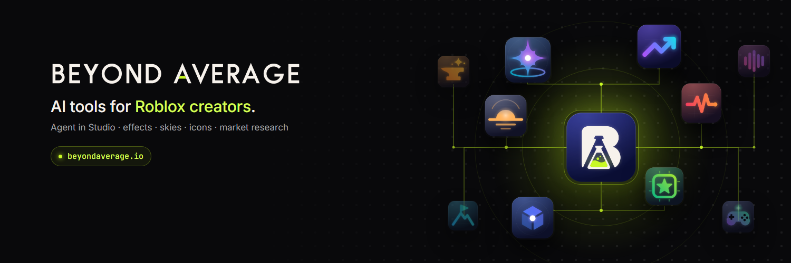
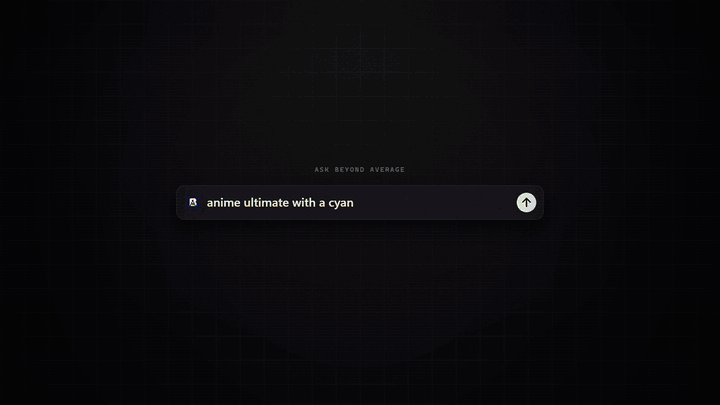
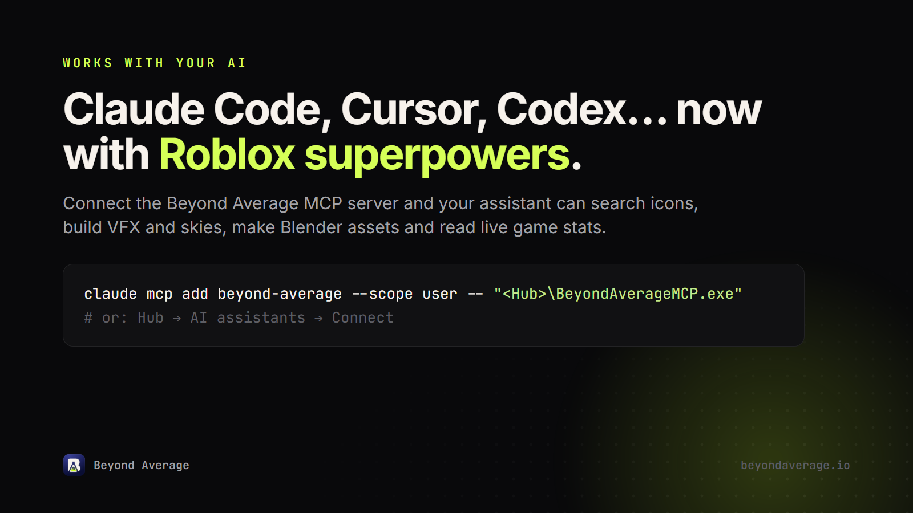

<p align="center">
  <a href="https://beyondaverage.io"></a>
</p>

<p align="center">
  <b>AI tools for Roblox creators.</b><br>
  An agent that works inside Roblox Studio, plus VFX, skies, icons, 3D models and live market data.<br>
  One Hub. Every app free.
</p>

<p align="center">
  <a href="https://beyondaverage.io"><b>Website</b></a> ·
  <a href="docs/mcp-setup.md"><b>MCP setup</b></a> ·
  <a href="docs/cli.md"><b><code>ba</code> CLI</b></a> ·
  <a href="docs/tools.md"><b>Tool list</b></a> ·
  <a href="https://x.com/beyondaverageai"><b>X / Twitter</b></a>
</p>

<p align="center">
  
  
  <a href="https://www.npmjs.com/package/@beyondaverage/cli"></a>
  
</p>

---

<p align="center">
  
</p>

## What is Beyond Average?

Beyond Average is the toolkit a Roblox studio built to ship its own games (11M+ visits), turned into free desktop apps. It has three parts:

- **Beyond Average Hub and its apps.** One sign-in to install, update and open every app.
- **The MCP server.** It gives Claude Code, Cursor, Codex, Claude Desktop, VS Code and Gemini CLI the suite's 106 Roblox tools.
- **`ba`, BA Agent in your terminal.** A coding agent that knows Roblox and drives the apps and Studio.

| App | What it does |
|---|---|
| **Flare** | Describe a particle effect, watch it live, let the AI polish it and send it to Studio. |
| **Horizon** | Describe a sky, watch it render live and send the six faces plus matching lighting to Studio. |
| **Glyph** | Search, recolour and export your licensed icon packs, and make gamepass icons. |
| **Kiln** | Low-poly meshes, PBR materials and rigs built in your own Blender, with GPU renders and bakes. |
| **Game Studio** | Whole games built by AI in phases, with your approval at every gate, applied straight into your open place. |
| **Trendwatch** | Roblox market research: charts, risers, breakouts and game name checks. |
| **Vitals** | Live ops for your own games: players, visits, events and read-only DataStores. |
| **Forge** | Upload assets to Roblox in safe batches and keep a catalog of every asset ID. |
| **Soundstage** | Browse, tag and loudness-match music and sound effects. |
| **Outpost** | Every game project, phase and place in one command centre. |

Every app is free. Plans only add AI credits.

## Quick start

1. **Sign up** at [beyondaverage.io](https://beyondaverage.io/signup). It's free.
2. **Download Beyond Average Hub** for Windows from [beyondaverage.io/downloads](https://beyondaverage.io/downloads), install it and sign in.
3. **Connect your AI assistant.** In the Hub, open **AI assistants** and click **Connect** next to your client. The Hub writes the config for you and keeps a backup.
4. **Ask it for something Roblox**, for example:

   > Make a golden holy-strike VFX and send it to my open Studio place.

Prefer doing it by hand? Every client's config is in **[docs/mcp-setup.md](docs/mcp-setup.md)**.

## Connect your AI assistant

<p align="center"></p>

The Hub installs a small launcher, `BeyondAverageMCP.exe`, next to itself. Every client starts the server through it, so you never have to update your config when the Hub updates. With the default install location:

```
C:\Users\<you>\AppData\Local\Programs\Beyond Average\Beyond Average Hub\BeyondAverageMCP.exe
```

The Hub's **AI assistants** page shows the exact path on your PC, with a copy button.

**Claude Code**

```powershell
claude mcp add beyond-average --scope user -- "C:\Users\<you>\AppData\Local\Programs\Beyond Average\Beyond Average Hub\BeyondAverageMCP.exe"
```

**Cursor** (`~/.cursor/mcp.json`)

```json
{
  "mcpServers": {
    "beyond-average": {
      "type": "stdio",
      "command": "C:\\Users\\<you>\\AppData\\Local\\Programs\\Beyond Average\\Beyond Average Hub\\BeyondAverageMCP.exe",
      "args": []
    }
  }
}
```

**Codex CLI, Codex IDE extension and the ChatGPT (Codex) desktop app** (`~/.codex/config.toml`)

```toml
[mcp_servers.beyond-average]
command = 'C:\Users\<you>\AppData\Local\Programs\Beyond Average\Beyond Average Hub\BeyondAverageMCP.exe'
args = []
startup_timeout_sec = 30
tool_timeout_sec = 600
```

Claude Desktop, VS Code (Copilot agent mode), Gemini CLI and any other MCP client: see **[docs/mcp-setup.md](docs/mcp-setup.md)**. Ready-to-copy files are in [`examples/`](examples).

### Or let your assistant do it

Paste this into Claude Code, Cursor or Codex and it connects itself, then walks you through setting up the suite. The full text is in **[docs/setup-prompt.md](docs/setup-prompt.md)**.

```text
Connect the Beyond Average MCP server to this assistant, then help me set up the suite.
Setup guide: https://github.com/beyondaverageai/beyond-average/blob/main/docs/mcp-setup.md
```

## `ba`: BA Agent in your terminal

```powershell
npm i -g @beyondaverage/cli    # or: Hub → Settings → Updates → Command line (ba), no Node needed
ba login
cd MyGame
ba
```

`ba` works in the folder it starts in, like a coding agent: it reads and edits files, runs commands, and with the Hub installed it drives the suite's apps and Roblox Studio. Every edit is shown as a diff and asks first. More in **[docs/cli.md](docs/cli.md)**.

## What your assistant can do

106 tools when every app is installed (fewer appear for apps you haven't installed). Highlights:

| Area | Tools | Examples |
|---|---|---|
| VFX | `flare_*` (15) | Build particle effects layer by layer, preview frames, send to Studio |
| Skies | `horizon_*` (10) | Design a skybox live, preview it, send the faces and lighting to Studio |
| Icons | `glyph_*` (9) | Search licensed icon packs, recolour and export at Roblox sizes, make gamepass icons |
| 3D | `kiln_*` (10) | Build low-poly meshes and PBR materials in Blender, rig to R15, queue GPU renders |
| Whole games | `gamestudio_*` (9) | Start a game, read phase outputs, preview and apply scripts to the open place |
| Market | `trendwatch_*` (12) | Charts, breakouts, genre share, game studies, name checks |
| Live ops | `vitals_*` (8) | Live players, history, events, read-only DataStore entries |
| Assets | `forge_*` (8) | Search your asset catalog, queue uploads (held for your approval), export IDs as Luau |
| Audio | `soundstage_*` (8) | Search your library and the Creator Store, loudness-matched Luau sound modules |
| Projects | `outpost_*` (8) | Projects, phases, docs, resume prompts, live Studio status |
| Suite | `suite_*`, `hub_*` (9) | Setup checklist, install and open apps, show images |

Full list: **[docs/tools.md](docs/tools.md)**.

## How it works

- **Local first.** The server runs on your PC and acts as you, through the apps you have installed. Your files and game data stay on your machine.
- **You approve what matters.** Uploads to Roblox are held in Forge until you approve them. Game Studio phases that cost credits say so first. The tools never save or publish your place.
- **Keys stay in the vault.** Your Roblox API key lives in the suite's encrypted vault (any app: Settings → API keys). The tools can tell whether a key exists but never read or print it, and no assistant should ask you to paste one.
- **Windows.** The desktop apps and the MCP server run on Windows 10 and 11. `ba` from npm also runs on macOS and Linux with its file and command tools.

## FAQ

**Does it cost anything?** No. Every app is free. Plans add AI credits for the in-app agent and AI features.

**Does ChatGPT on the web work?** Not yet. ChatGPT in the browser only connects to remote HTTPS servers, and Beyond Average runs on your PC. Use the ChatGPT (Codex) desktop app instead.

**My client doesn't see the tools.** Restart the client after connecting, then check that the Hub is installed and you're signed in. Ask the assistant to run `suite_setup_status` for a checklist. More fixes are in [docs/mcp-setup.md](docs/mcp-setup.md#troubleshooting).

**Is the suite open source?** No. This repo holds the public docs, setup examples and issue tracker. The apps are free to use under the [terms](https://beyondaverage.io/terms).

## Links

- Website: [beyondaverage.io](https://beyondaverage.io)
- X / Twitter: [@beyondaverageai](https://x.com/beyondaverageai)
- npm: [@beyondaverage/cli](https://www.npmjs.com/package/@beyondaverage/cli)
- Bugs and ideas: [open an issue](../../issues)
- Security: [SECURITY.md](SECURITY.md)

## License

The docs and config examples in this repository are [MIT licensed](LICENSE). The Beyond Average apps, the `ba` CLI and the MCP server are free to use under the [Beyond Average terms](https://beyondaverage.io/terms). The Beyond Average name, logo and app icons in `assets/` are trademarks of Beyond Average Studios LLC and are not covered by the MIT license.

Roblox and Roblox Studio are trademarks of Roblox Corporation. Beyond Average is not affiliated with or endorsed by Roblox.
